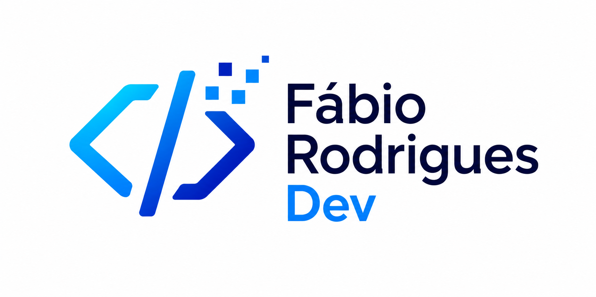

<div align="center">



# Portfólio — Fabio Rodrigues

**Meu portfólio profissional: serviços, tecnologias, projetos e currículo.**

<a href="https://fabiorodriguesdev.com.br"></a> 

   

</div>

---

## 📌 Sobre o projeto

Site onde apresento meu trabalho como **Desenvolvedor Full Stack**: o que eu faço, como trabalho e os projetos que já entreguei.

## ✨ Funcionalidades

- **Serviços** oferecidos e **processo** de trabalho
- **Tecnologias** e **habilidades**
- **Projetos** entregues para clientes
- **Depoimentos** e formação
- **Currículo** para download e contato

## 🧠 Destaques técnicos

- **React + Vite** com componentes reutilizáveis
- Conteúdo centralizado em `src/data/` para atualizar fácil
- SEO com `sitemap.xml` e `robots.txt`
- Domínio próprio e hospedagem na **Vercel**

## 🚀 Como rodar localmente

```bash
git clone https://github.com/fabiorodrigueslima/Meuportifolio.git
cd Meuportifolio
npm install
npm run dev
```

<details>
<summary><b>📚 Guia técnico completo</b> (configuração, comandos e publicação)</summary>

Portfólio profissional de Fábio Rodrigues, Desenvolvedor Full Stack e Python. O projeto apresenta serviços, tecnologias, formação em andamento e soluções desenvolvidas.

## Tecnologias

- React e Vite
- JavaScript, HTML e CSS
- React Icons

## Executar localmente

```bash
npm install
npm run dev
```

## Verificações

```bash
npm run lint
npm run build
```

## Conteúdo para atualizar

Textos, links de contato e a URL do currículo ficam centralizados, quando aplicável, em `src/data/portfolio.js`. Antes de publicar novos projetos, confirme problema resolvido, participação, tecnologias, status, demonstração e repositório.

Para publicar o currículo:

1. substitua o arquivo em `public/curriculo-fabio-rodrigues.pdf`;
2. mantenha `RESUME_AVAILABLE` como `true` em `src/data/portfolio.js`;
3. execute o lint e o build antes da publicação.

## Pendências editoriais

- Confirmar depoimentos reais e autorização para publicação antes de reativar uma seção de prova social.
- Complementar os projetos com funcionalidades, repositórios públicos e resultados verificáveis.
- Substituir a imagem social atual por uma arte definitiva de 1200 × 630 px.

</details>

---

## 👨‍💻 Autor

**Fabio Rodrigues de Lima** — Desenvolvedor Full Stack

[](https://fabiorodriguesdev.com.br)
[](https://github.com/fabiorodrigueslima)
[](https://www.linkedin.com/in/f%C3%A1bio-rodrigues-a89b543a4)
